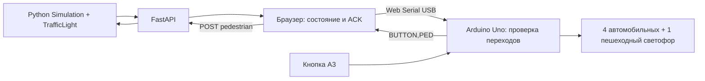

# AdaptiveTraffic V3 — отчёт 25.10.2026

Исторический отчёт этапа V3. Последующая публикация и проверки описаны в
[актуальном отчёте Amvera](AMVERA_STATUS_RU.md).

Программные этапы выполнены. **Автоматические проверки PASS**; физическая приёмка
и развёртывание у провайдера требуют платы/аккаунта. Commit, push, покупка хостинга
и публикация не выполнялись. Ветка main, исходный HEAD 980932d.

## 1. Добавленные файлы

- `.dockerignore`
- `Dockerfile`
- `adaptive_traffic/serve.py`
- `adaptive_traffic/server_config.py`
- `adaptive_traffic/web_security.py`
- `amvera.yaml`
- `deploy/compose.yaml`
- `docs/DEPLOY_AMVERA_RU.md`
- `docs/DEPLOY_VPS_RU.md`
- `docs/V3_REPORT_RU.md`
- `hardware/PROTOCOL.md`
- `hardware/README_RU.md`
- `hardware/WIRING.md`
- `hardware/arduino/AdaptiveTrafficArduino/AdaptiveTrafficArduino.ino`
- `hardware/arduino/AdaptiveTrafficArduino/TrafficProtocol.h`
- `hardware/simulator.cpp`
- `hardware/wiring.svg`
- `requirements-web.txt`
- `tests/frontend_safety.cjs`
- `tests/test_frontend_safety.py`
- `tests/test_hardware.py`
- `tests/test_hosting.py`
- `tools/check_web_hardware.py`
- `web/static/serial.js`

## 2. Изменённые файлы

- `README.md`
- `adaptive_traffic/web.py`
- `docs/web_api.md`
- `web/index.html`
- `web/static/app.js`
- `web/static/style.css`

## 3. Архитектура



Контроллеры, Config, Simulation, TrafficLight, presentation, генератор и
исследовательский код побайтно сохранены. Python остаётся источником решений;
Arduino обеспечивает проверку разрешённых переходов, GPIO и watchdog.

## 4. Четыре светофора

NORTH/SOUTH имеют общий цвет фазы NS, EAST/WEST — EW. В NS_GREEN зелёные N/S,
в EW_GREEN — E/W; соответствующие жёлтые включаются только на своих двух
подходах. Все ALL_RED, PED_GREEN и PED_CLEARANCE держат автомобили красными.
Пешеходный зелёный существует только в PED_GREEN, в clearance он выключен.

## 5–8. GPIO, светодиоды, резисторы, кнопка

| Направление | RED | YELLOW | GREEN |
|---|---|---|---|
| NORTH | D2 | D3 | D4 |
| SOUTH | D5 | D6 | D7 |
| EAST | D8 | D9 | D10 |
| WEST | D11 | D12 | A0 |
| Пешеход | A1 | — | A2 |

Кнопка A3 ↔ GND, INPUT_PULLUP, debounce 40 мс. D0/D1 оставлены для Serial,
D13 свободен. Всего **14 LED: 5 красных, 4 жёлтых, 5 зелёных** и **14 отдельных
резисторов 1 кОм**. Каждый GPIO → резистор → анод LED, катод → общая GND.
A0–A3 используются как цифровые выводы. Питание только USB.

Расчёт при 5 В: не более 5 мА на ветвь даже при нулевом падении на LED;
штатно пять LED — максимум 25 мА. Пределы групп, допуски и вариант 680 Ом
разобраны в [WIRING.md](../hardware/WIRING.md). Точная схема —
[wiring.svg](../hardware/wiring.svg).

## 9–10. Прошивка и загрузка

[AdaptiveTrafficArduino.ino](../hardware/arduino/AdaptiveTrafficArduino/AdaptiveTrafficArduino.ino)
и лежащий рядом TrafficProtocol.h. Arduino IDE → пакет Arduino AVR Boards →
Arduino Uno → фактический порт платы → Upload. После загрузки закройте
Serial Monitor, чтобы порт мог занять браузер. Сторонние Arduino-библиотеки
не требуются. [Пошаговая инструкция](../hardware/README_RU.md).

## 11–12. Подключение и синхронизация

В Chrome/Chromium на компьютере с Uno откройте localhost или будущий
HTTPS-сайт. «Физический макет» → «Подключить Arduino» → выбрать порт →
источник/контроллер → «Синхронизировать и запустить ×1».

Синхронизация перезапускает выбранную сессию/всё сравнение и удаляет ручные
события, но сохраняет исходный TrafficPlan. После SYNC автомобильный ALL_RED
выдерживается 4 с. Затем каждый модельный шаг передаётся через STATE и ждёт
ACK. Следующий шаг выполняется не раньше 1010 мс после подтверждения;
из-за USB/сети фактический темп немного медленнее идеальной ×1. Показанная
физическая фаза основана на ACK; UNKNOWN означает отсутствие подтверждения.

## 13. Безопасность

115200 baud, версия/идентификация устройства, uint32 sequence, идемпотентный
повтор последней команды, ограниченный 96-байтный буфер, таймаут частичной
строки 500 мс, heartbeat около 500 мс и watchdog 2500 мс. Неверная команда,
номер, переход, временной скачок или потеря связи закрывают зелёные.
После ошибки требуется HELLO/SYNC. Защитные интервалы измеряются Arduino
через millis(): yellow=3 с, all_red=1 с, ped_green=10 с, clearance=3 с.

Браузер проверяет session id/revision, модельное время, свежесть HTTP и ACK.
Ускорение блокируется; fast-forward, пауза и смена источника снимают вывод
через STOP. Скрытие вкладки отменяет в том числе ещё незавершённый SYNC.
При снятии USB-питания лампы гаснут. До setup() защита программой не действует.
ACK не измеряет исправность проводки. [Точная спецификация](../hardware/PROTOCOL.md).

## 14. Compare с макетом

Выберите 2–4 алгоритма в Compare, включая FIXED и V2; затем источник
«Сравнение» и один контроллер в разделе макета. Все виртуальные модели
получают один TrafficPlan и одинаковые ручные/пешеходные события. Только
выбранная модель выводится на физические LED. Смена вывода требует нового
ALL_RED и явной синхронизации с перезапуском сравнения.

## 15. Локальный запуск

```bash
.venv/bin/python main.py --web
```

Адрес: http://127.0.0.1:8000. Остановка Ctrl+C. Сайт без Arduino сохраняет
симулятор, Compare, Laboratory, CSV/диагностику/анализ и старые результаты.

## 16. Amvera и VPS

Подготовлены Dockerfile, .dockerignore, amvera.yaml, production-команда
`python -m adaptive_traffic.serve`, /healthz, TrustedHost, явные origins,
секретный ключ лаборатории, rate limiter и пределы сессий/задач. Один worker.
VPS Compose дополнительно задаёт CPU 0,25 / RAM 448 МиБ / PID 64.

[Инструкция Amvera](DEPLOY_AMVERA_RU.md) и [инструкция VPS](DEPLOY_VPS_RU.md)
содержат настройку GitHub, переменных, HTTPS, постоянного тома, проверок и
обновлений. В тарифах Amvera на дату проверки указан «Начальный» 290 ₽/30 дней
с 500 МБ RAM; цену нужно проверить перед оплатой. Адрес не выдуман:
опубликованного сайта пока нет.

## 17. Автоматические проверки

- Начальная версия: 231 passed.
- Итог: **265 passed, 0 failed, 0 errors, 0 skipped, 1 warning**, 3,65 с.
- Предупреждение StarletteDeprecationWarning относится к httpx в TestClient;
  существовавшая зависимость не менялась ради предупреждения.
- C++: четыре исходных контроллера с пешеходами воспроизводятся на настоящем
  ядре прошивки; инварианты ламп, неверные/повторные команды, watchdog,
  короткие интервалы, дребезг, переполнение и wrap millis проверены.
- Chromium + настоящий FastAPI + программный USB-адаптер к тому же C++:
  синхронизация, ручная пробка, физическое событие кнопки, PED и EW,
  потеря ACK, watchdog, reconnect, запрет ×100, fast-forward, выбор V2/FIXED
  из Compare, отмена SYNC, четыре алгоритма и 12 лабораторных запусков PASS.
- JS safety-тест отдельно проверяет скрытие вкладки во время SYNC,
  устаревшую revision, пропуск шага и неправильный ACK.
- Production-команда поднялась; Host/Origin/ключ/лимиты проверены через HTTP,
  четыре контроллера завершены, лаборатория 9/9, штатное завершение сервера.
  VmHWM в этом небольшом прогоне 60284 КиБ (около 59 МиБ), не гарантия пиков
  при произвольной нагрузке. Все собственные тестовые серверы остановлены.
- Старый научный код и reference_results.json побайтно совпали с началом работы.

## 18. Компиляция Uno

**PASS**, FQBN arduino:avr:uno, пакет arduino:avr 1.8.8, Arduino CLI
1.5.2-rc.1 из официального дистрибутива. Flash 6574/32256 байт (20%),
статическая RAM 849/2048 байт (41%); для локальных данных остаётся 1199 байт.
Компиляция не означает физическую проверку.

## 19–21. Проверки с оборудованием и покупки

Реальная Uno не подключалась. После получения платы нужны: проверка GPIO,
полярности/номиналов, замеры токов/яркости, загрузка и reset, USB-разрешение,
реальная кнопка/контактный дребезг, длительное соединение, питаемый обрыв связи
и отсутствие питания при выдёргивании USB. Никакой симулятор этого не заменяет.

Сверьте набор: Uno R3, USB-B data-кабель, breadboard, провода, одна кнопка,
5 красных + 4 жёлтых + 5 зелёных LED, 14 резисторов 1 кОм. Докупите только
недостающее; состав Starter Kit не предполагается заранее. Полезен мультиметр
для измерений. Собирайте при снятом USB-питании по SVG, сначала проверьте
один LED, затем весь макет, загрузите скетч, закройте Serial Monitor и
проведите безопасный тест светодиодов на сайте (FIXED, 80 с + drain).

## 22. Демонстрация учителю за две минуты

Заранее загрузить прошивку и подключить USB. Создать NS_HEAVY / V2 / seed 42.
Показать четыре подхода → подключить макет → синхронизировать ×1 → добавить
«Пробка NS» → нажать настоящую кнопку → показать запрос, жёлтый, ALL_RED и
PED_GREEN. Затем безопасно отключить вывод, открыть Compare FIXED/V2,
нажать «До конца» и объяснить реальные метрики. Для показа выбранного
алгоритма сравнения отдельно подключить источник Compare через новый SYNC.

## 23. Оставшиеся ограничения

Это учебный макет: нет физической приёмки, сертификации, датчиков обратного
контроля ламп или независимого аппаратного watchdog. При потере питания нет
светящихся красных. Hardware mode только ×1, с безопасным отставанием;
каждая новая синхронизация сбрасывает текущий опыт и ручные события.

Сессии в памяти исчезают при рестарте; один процесс и одна лаборатория.
На публичном сервере генерация ограничена 600 с, лаборатория требует ключ и
имеет лимит между отдельными опытами. Большой holdout лучше выполнять локально.
Проверки на хостинге, сертификат и права его постоянного тома требуют панели.
Docker отсутствует в текущем окружении: образ не собирался/не запускался;
проверены файлы конфигурации и сам production-процесс Uvicorn. Нагрузочное
тестирование на тарифе Amvera пока не выполнялось.

## 24. git diff --stat

```text
 README.md               | 71 ++++++++++++++++++++++++++++++++++--
 adaptive_traffic/web.py | 95 +++++++++++++++++++++++++++++++++++++------------
 docs/web_api.md         | 32 +++++++++++++++--
 web/index.html          | 49 +++++++++++++++++++++++++
 web/static/app.js       | 80 ++++++++++++++++++++++++++++++++++++-----
 web/static/style.css    | 11 ++++++
 6 files changed, 303 insertions(+), 35 deletions(-)
```

Статистика не включает новые untracked-файлы из пункта 1.

## 25. git status

```text
On branch main
Your branch is up to date with 'origin/main'.

Changes not staged for commit:
  (use "git add <file>..." to update what will be committed)
  (use "git restore <file>..." to discard changes in working directory)
	modified:   README.md
	modified:   adaptive_traffic/web.py
	modified:   docs/web_api.md
	modified:   web/index.html
	modified:   web/static/app.js
	modified:   web/static/style.css

Untracked files:
  (use "git add <file>..." to include in what will be committed)
	.dockerignore
	Dockerfile
	adaptive_traffic/serve.py
	adaptive_traffic/server_config.py
	adaptive_traffic/web_security.py
	amvera.yaml
	deploy/
	docs/DEPLOY_AMVERA_RU.md
	docs/DEPLOY_VPS_RU.md
	docs/V3_REPORT_RU.md
	hardware/
	requirements-web.txt
	tests/frontend_safety.cjs
	tests/test_frontend_safety.py
	tests/test_hardware.py
	tests/test_hosting.py
	tools/
	web/static/serial.js

no changes added to commit (use "git add" and/or "git commit -a")
```

Индекс пуст; ни commit, ни push не выполнялись.

Протоколы проверки (игнорируются Git):
[pytest.xml](../results/v3_verification/pytest.xml),
[сборка Uno](../results/v3_verification/arduino_compile.txt),
[production](../results/v3_verification/production_audit.json),
[неизменность модели](../results/v3_verification/model_integrity.json),
[Chromium](../results/v3_browser_20261025_164150/browser_audit.json).
