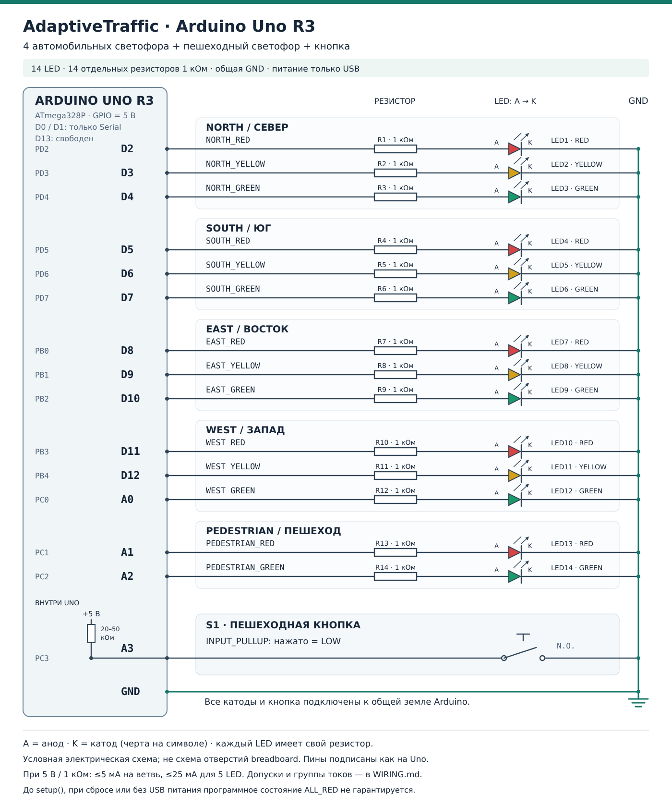

# AdaptiveTraffic: подключение Arduino Uno R3

Четыре автомобильных светофора содержат по три отдельных LED, пешеходный — два. Всего **14 LED, 14 отдельных резисторов и одна кнопка**. Питание макета — только USB от компьютера. Автомобили и очереди остаются в Python-симуляции.



[Открыть SVG для печати и увеличения](wiring.svg). Это условная электрическая схема соединений, а не расположение отверстий на макетной плате. Обозначения выводов соответствуют надписям на разъёмах Uno R3, не номерам ножек корпуса микроконтроллера.

## Детали

| Деталь | Количество | Примечание |
|---|---:|---|
| Arduino Uno R3, ATmega328P | 1 | Питание и Serial по USB |
| Обычный красный LED | 5 | NORTH, SOUTH, EAST, WEST, пешеход |
| Обычный жёлтый LED | 4 | По одному на автомобильный светофор |
| Обычный зелёный LED | 5 | NORTH, SOUTH, EAST, WEST, пешеход |
| Резистор **1 кОм**, 0,125 Вт или больше | **14** | Один последовательно с каждым LED; основной вариант |
| Нормально разомкнутая кнопка | 1 | Между A3 и GND |
| Макетная плата, перемычки, USB-кабель передачи данных | По необходимости | Общая земля для всех цепей |

Используются отдельные маломощные LED. Готовый модуль с общим анодом, встроенными резисторами или транзисторами требует собственной схемы и сюда автоматически не подходит.

## Таблица соединений

Каждая строка LED означает отдельную последовательную цепь:

```text
GPIO Arduino → резистор 1 кОм → анод LED (A) → катод LED (K) → GND Arduino
```

`HIGH` включает LED, `LOW` выключает. Катод обычно отмечен плоской стороной корпуса и более короткой ножкой; после обрезки ножек ориентируйтесь на документацию детали или проверку мультиметром. Не соединяйте GPIO напрямую с LED и не заменяйте индивидуальные резисторы одним общим.

| Сигнал | Разъём Uno | Порт ATmega328P | Резистор / LED на схеме |
|---|---|---|---|
| NORTH_RED | D2 | PD2 | R1 / LED1 |
| NORTH_YELLOW | D3 | PD3 | R2 / LED2 |
| NORTH_GREEN | D4 | PD4 | R3 / LED3 |
| SOUTH_RED | D5 | PD5 | R4 / LED4 |
| SOUTH_YELLOW | D6 | PD6 | R5 / LED5 |
| SOUTH_GREEN | D7 | PD7 | R6 / LED6 |
| EAST_RED | D8 | PB0 | R7 / LED7 |
| EAST_YELLOW | D9 | PB1 | R8 / LED8 |
| EAST_GREEN | D10 | PB2 | R9 / LED9 |
| WEST_RED | D11 | PB3 | R10 / LED10 |
| WEST_YELLOW | D12 | PB4 | R11 / LED11 |
| WEST_GREEN | A0 | PC0 | R12 / LED12 |
| PEDESTRIAN_RED | A1 | PC1 | R13 / LED13 |
| PEDESTRIAN_GREEN | A2 | PC2 | R14 / LED14 |
| PEDESTRIAN_BUTTON | A3 | PC3 | S1 между A3 и GND |

Распиновка сверена с [официальной схемой выводов Uno R3](https://docs.arduino.cc/resources/pinouts/A000066-full-pinout.pdf). A0–A3 используются как цифровые GPIO; Arduino поддерживает эти имена в `pinMode`, `digitalRead` и `digitalWrite`: [справочник digitalWrite](https://docs.arduino.cc/language-reference/en/functions/digital-io/digitalwrite/).

**D0/RX и D1/TX оставьте свободными для Serial. D13 не подключайте к макету.** A4/A5 также не используются. Не подключайте внешний источник к VIN, разъёму питания или 5V одновременно с этой USB-схемой.

## Пешеходная кнопка

Один контакт нормально разомкнутой кнопки соедините с **A3**, второй с общей **GND**. Прошивка включает `pinMode(A3, INPUT_PULLUP)`: отпущенная кнопка читается как `HIGH`, нажатая — как `LOW`. Внешний подтягивающий резистор не нужен. Четырёхножечная тактовая кнопка обычно имеет постоянно соединённые пары ножек: мультиметром выберите два контакта, которые замыкаются именно при нажатии.

Кнопка создаёт событие запроса; непосредственно к пешеходному LED она не подключается. Защитные интервалы и разрешение пешеходной фазы определяет Python-модель, а прошивка проверяет допустимость физических переходов. Внутренняя подтяжка Uno имеет порядок 20–50 кОм, поэтому при нажатии добавляет не более 0,25 мА при 5 В. [Официальное описание Uno R3](https://store.arduino.cc/products/arduino-uno-rev3/)

## Расчёт токов

Для отдельной ветви:

```text
I_LED ≈ (V_GPIO − V_f) / R
верхняя оценка при V_f = 0: I_LED ≤ V_supply / R
P_R ≤ V_supply² / R
```

При 5 В, 1 кОм и условном `V_f = 2,0 В` получается около **3 мА**. Это пример расчёта, а не измерение выбранного LED. Реальная яркость и прямое напряжение зависят от детали; падение напряжения на GPIO дополнительно уменьшает ток. Проверьте паспорт и яркость имеющихся LED на собранном макете.

| Оценка при ровно 5 В, номинальные резисторы | **1 кОм — основной вариант** | 680 Ом — опционально |
|---|---:|---:|
| Один LED, пример `V_f = 2,0 В` | 3,00 мА | 4,41 мА |
| Один вывод, даже при коротком замыкании LED после резистора | ≤5,00 мА | ≤7,36 мА |
| 5 одновременно горящих LED, `V_f = 0` | ≤25,00 мА | ≤36,77 мА |
| Все 14 LED при ошибке программы, `V_f = 0` | ≤70,00 мА | ≤102,95 мА |
| Мощность одного резистора, `V_f = 0` | ≤25,00 мВт | ≤36,77 мВт |

Штатно включено не больше пяти LED: по одному в каждом из четырёх автомобильных светофоров и один пешеходный. Во время пешеходного зелёного это четыре автомобильных красных и пешеходный зелёный. Четырнадцать одновременно включённых LED выше рассматриваются только как оценка электрической нагрузки при ошибке; такое состояние для движения недопустимо.

Допуск резистора и напряжения нельзя игнорировать: если принять **5,25 В и резистор с допуском ±5%**, то для 1 кОм получим `5,25 / 950 = 5,53 мА` на ветвь, до **27,64 мА** на пять ветвей и **77,37 мА** на все четырнадцать. Для 680 Ом соответствующие оценки — **8,13 / 40,64 / 113,78 мА**. Это расчётный сценарий с запасом, не результат измерения питания.

680 Ом допустимы только после проверки выбранных LED и всех токов; начинать следует с **1 кОм**. Короткое замыкание непосредственно между GPIO и GND в обход резистора этим расчётом не защищено.

### Выводы, группы и питание ATmega328P

Arduino указывает **20 мА на GPIO как рекомендуемое рабочее условие**, а **40 мА — абсолютный предел**, не целевой ток. [Описание входов и выходов Uno R3](https://store.arduino.cc/products/arduino-uno-rev3/)

Для ATmega328P паспорт задаёт абсолютный предел **200 мА через VCC/GND**, суммарный выходной ток `I_OH` до **150 мА** в каждой из двух групп и входящий ток `I_OL` до **100 мА** в каждой из трёх групп. Наша схема выдаёт ток из GPIO (`source`). Группы не совпадают с отдельными буквенными портами. [Microchip DS40002061A, разделы 29.1–29.2, Absolute Maximum Ratings и DC Characteristics](https://ww1.microchip.com/downloads/en/DeviceDoc/ATmega48A-PA-88A-PA-168A-PA-328-P-DS-DS40002061A.pdf)

| Группа выходного тока `I_OH` | LED нашей разводки | Все её LED при 5 В / 1 кОм | При 5,25 В / 950 Ом | Предел группы |
|---|---|---:|---:|---:|
| PC0–PC5, PD0–PD4, ADC7, RESET | D2–D4, A0–A2: 6 LED | ≤30 мА | ≤33,16 мА | 150 мА |
| PB0–PB5, PD5–PD7, ADC6, XTAL1/XTAL2 | D5–D12: 8 LED | ≤40 мА | ≤44,22 мА | 150 мА |

ADC6/ADC7 не выведены на разъёмы Uno; они перечислены для точного соответствия паспортным группам. При 680 Ом, 5,25 В и −5% допуске резисторов две LED-группы дают не более **48,77 и 65,02 мА**. К первой группе добавляется ток подтяжки нажатой кнопки — до 0,263 мА при 5,25 В.

Для полноты: принимающие ток группы — PC0–PC5/ADC6/ADC7, PB0–PB5/PD5–PD7/XTAL1/XTAL2, PD0–PD4/RESET; предел каждой — 100 мА. Не переподключайте LED к +5V с управлением через `LOW`: это другая схема и другая проверка групп. [Тот же паспорт Microchip, примечания к DC Characteristics](https://ww1.microchip.com/downloads/en/DeviceDoc/ATmega48A-PA-88A-PA-168A-PA-328-P-DS-DS40002061A.pdf)

200 мА — предел **микроконтроллера**, не допустимый ток всех USB-потребителей платы. В бюджет ATmega328P входят также его собственное потребление, подтяжка и другие токи; 70 мА для LED при номинальных условиях не означают 70 мА для всей платы. Расчёт для 1 кОм оставляет большой запас, но не заменяет измерение собранного устройства. Не добавляйте к GPIO моторы, лампы или мощные LED.

## Сборка и первая проверка

1. Отключите USB. Соберите общую землю и прозвоните её до GND Uno. У некоторых breadboard шины питания разорваны посередине — при необходимости соедините их перемычкой.
2. Соберите 14 отдельных ветвей по таблице, проверяя сопротивление и полярность каждого LED. Не объединяйте NORTH/SOUTH или EAST/WEST на один GPIO: в этой разводке каждый светодиод имеет свой вывод.
3. Подключите кнопку A3–GND. Проверьте отсутствие короткого замыкания между питанием и землёй.
4. Загрузите `arduino/AdaptiveTrafficArduino/AdaptiveTrafficArduino.ino` с выбранной платой **Arduino Uno**. Затем используйте раздел сайта «Физический макет» и «Тест светодиодов» для проверки маркировки направлений и цветов.
5. Убедитесь, что NORTH/SOUTH работают парой NS, EAST/WEST — парой EW; пешеходный зелёный появляется только при четырёх автомобильных красных. Сверяйте последнее подтверждённое состояние, а не только отправленную команду.
6. Проверьте физическую кнопку, остановку heartbeat и повторное подключение. При прекращении обмена при сохранённом питании ожидается программный ALL_RED; при отключении USB питание исчезает и LED гаснут.

**До выполнения `setup()` и при сбросе/отсутствии питания программная защита не действует.** GPIO могут быть входами, а LED — выключенными; гарантировать горящие красные до запуска прошивки эта простая схема не может. Макет предназначен для учебной демонстрации, не для управления реальным дорожным движением.

Физическая сборка, токи, яркость и реальная Uno здесь **не проверены**. SVG и расчёты подготовлены по документации; перечисленные испытания требуется выполнить на имеющихся деталях.
